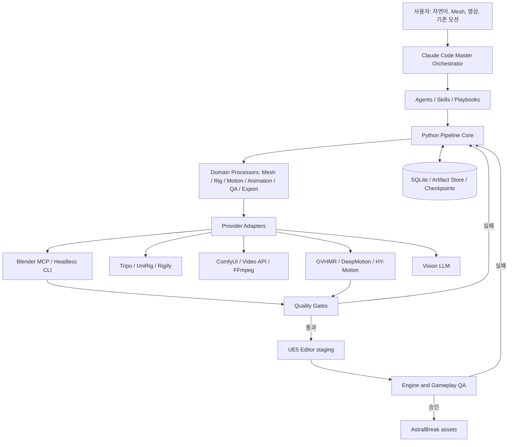
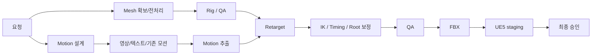
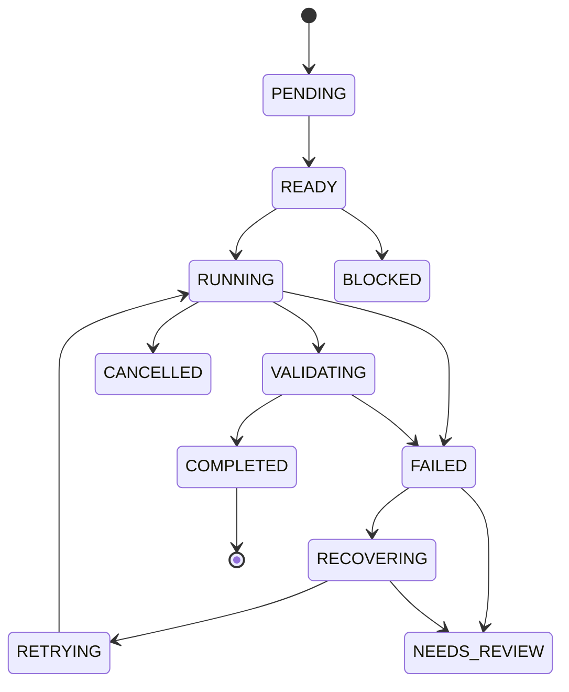
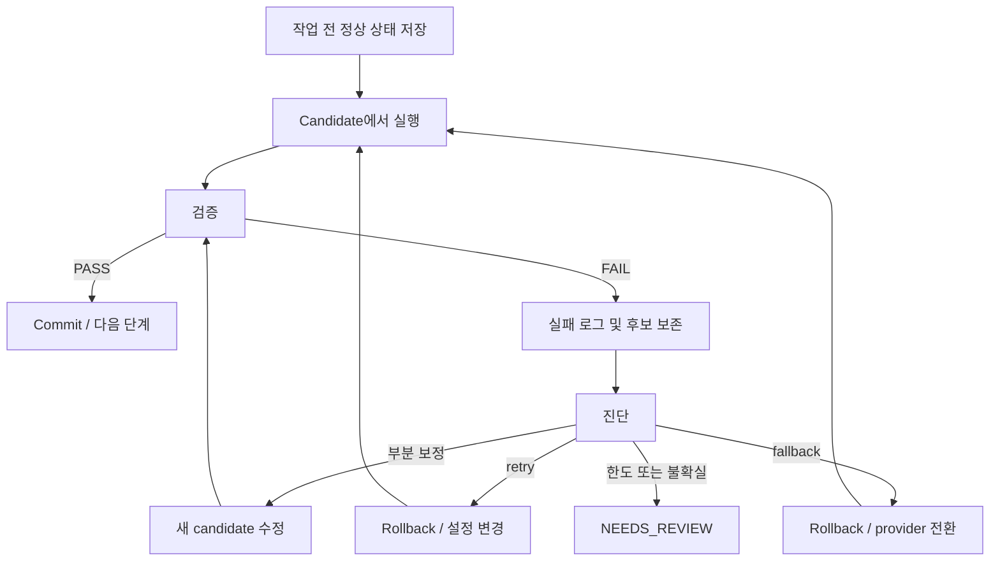
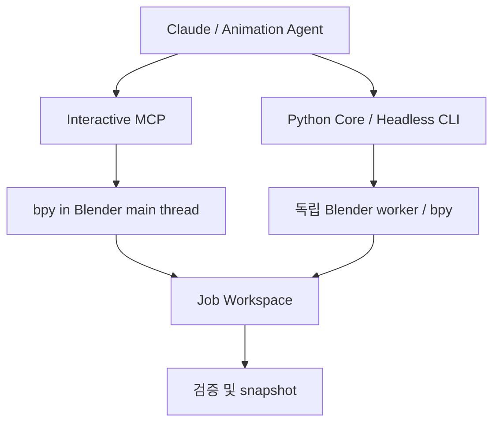
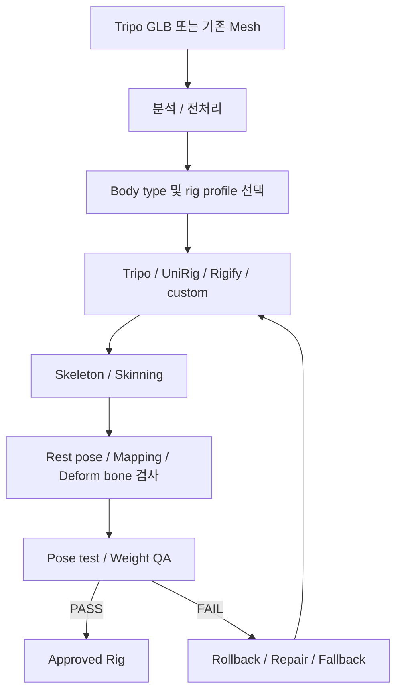
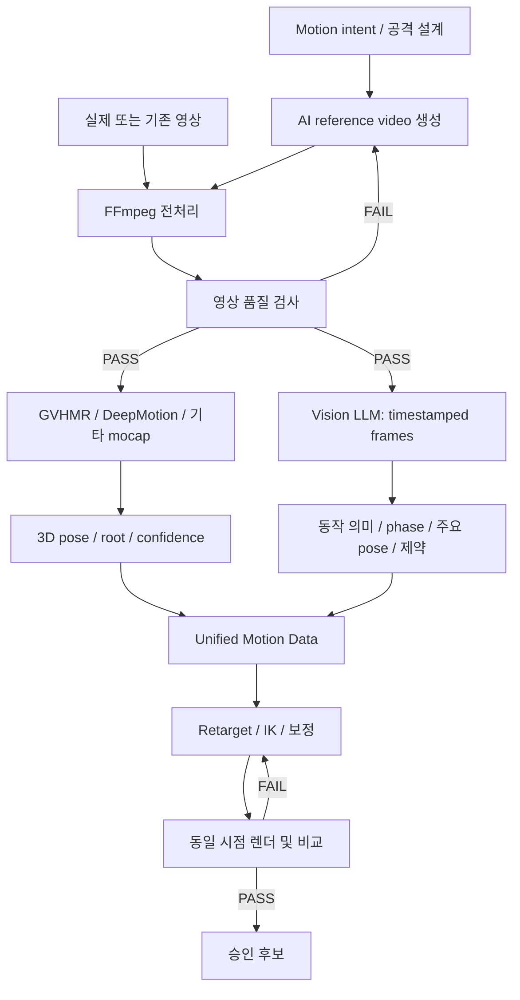
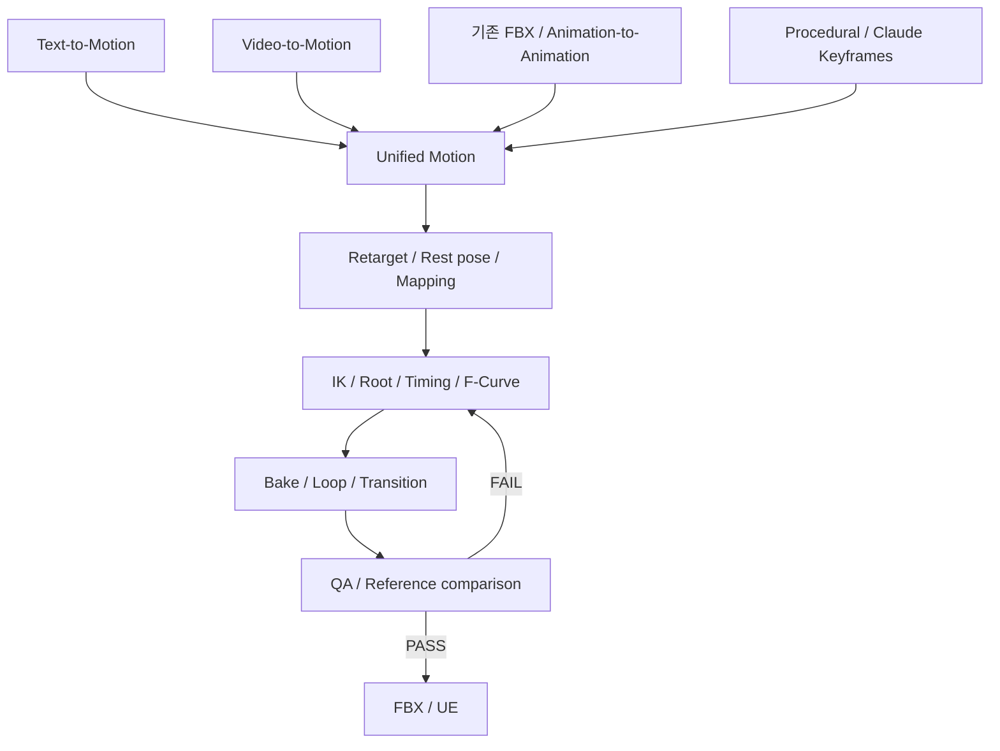
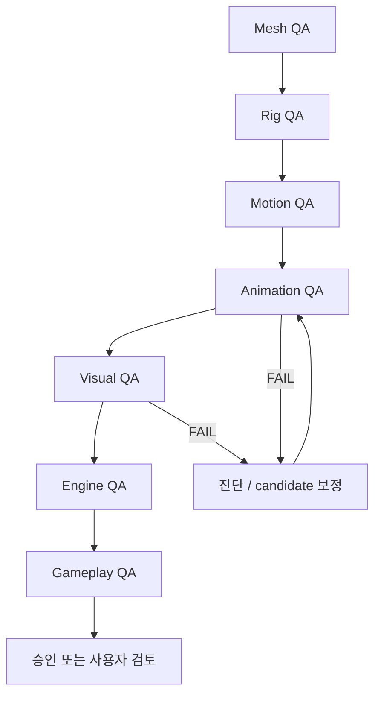

# AssetPipeline — Master Design v0.1

2026-11-26 | Claude Code / Blender / Unreal Engine 5.7.4

분할 문서의 전체 내용. 출처 검증 및 실행 테스트는 후속 PoC 대상이다.

## 목차
- 00_PROJECT_OVERVIEW
- 01_SYSTEM_ARCHITECTURE
- 02_AGENT_AND_SKILLS
- 03_PIPELINE_CORE
- 04_RECOVERY_SYSTEM
- 05_BLENDER_CONTROL
- 06_MESH_AND_RIGGING
- 07_VIDEO_AND_MOTION
- 08_ANIMATION_PIPELINE
- 09_DATA_SCHEMA
- 10_QUALITY_VALIDATION
- 11_UNREAL_INTEGRATION
- 12_IMPLEMENTATION_ROADMAP
- 13_REFERENCES
- 14_RISKS_AND_DECISIONS

# 프로젝트 정의 및 요구사항

Architecture v0.1 · 2026-11-26 · 목표 엔진 UE5.7.4 (소스 빌드). 프로젝트명 AssetPipeline은 임시 명칭이다. AstralBreak(4인 협동 PvE 액션 레이드)를 첫 적용 대상으로 하되 독립 저장소로 개발한다.

목표: Claude Code가 전문 AI 및 Blender를 활용하여 게임용 Mesh, Rig, Animation을 제작하고 검증하며 실패 시 복구하는 재현 가능한 제작 파이프라인. 런타임 AI가 아니라 Editor/오프라인 제작 도구다.

| ID | 요구사항 | 완료 조건 |
|---|---|---|
| FR-01 | Mesh 확보 | Tripo GLB 및 기존 FBX 입력, 원본 해시/출처 기록 |
| FR-02 | Mesh 처리 | 단위, 축, 재질, topology 검사 및 정리 |
| FR-03 | 자동 리깅 | Skeleton, skinning 생성 및 pose test |
| FR-04 | Blender 직접 제어 | Claude가 scene 조회, bone/weight/keyframe 수정 및 렌더링 |
| FR-05 | 레퍼런스 영상 생성 | 동작 명세에서 추적 가능한 영상 생성 |
| FR-06 | Video-to-Motion | 실제/AI 영상에서 3D 모션 추출 및 의미 분석 |
| FR-07 | Text-to-Motion | 자연어 기반 모션 생성 |
| FR-08 | Animation-to-Animation 및 Procedural | 기존 모션 수정, 직접 keyframe/IK 제작 |
| FR-09 | Retargeting | 다른 skeleton에 모션 적용 및 검증 |
| FR-10 | QA | 정량 검사, 렌더링 비교, 수정 및 재검증 |
| FR-11 | 복구 | Checkpoint, Rollback, Retry, Fallback, 재개 |
| FR-12 | UE5 연동 | Skeletal Mesh 및 Animation Sequence 임포트 |
| FR-13 | Gameplay 연동 | Montage, Notify, Motion Warping, Combat Metadata |
| FR-14 | Human review | 자동 해결 불가/중요 품질 판단 시 승인 요청 |
| FR-15 | Provenance | 입력, 도구 버전, 설정, 라이선스, 생성 이력 추적 |

원칙: Agentic, Modular, Recoverable, Self-validating, Reproducible, Human-in-the-loop, Engine-aware, Extensible. 정형 작업은 결정적 스크립트로 처리하되 AI 모델 결과의 완전한 결정성은 보장하지 않는다. 원본 보호와 비용 제한을 코드로 강제한다.

범위: 최초 PoC는 휴머노이드 1개와 공격 1개. 복잡한 크리처, 고품질 자동 retopology, 대규모 분산 실행은 후속 단계. 모든 도구가 검증된 통합 제품이라는 의미는 아니다.


---

# 전체 아키텍처



Control plane: Claude가 요구사항 해석, 계획, 도구 선택, 시각적 평가, 실패 진단 및 수정 전략을 담당한다. Execution plane: Python이 작업 실행, 파일/상태 관리, 정량 검사, 비용 제한, 복구를 강제한다. Claude 세션 종료와 무관하게 작업 재개 가능해야 한다.

| 계층 | 책임 |
|---|---|
| Agent/Skill | 전문 지식 및 작업 계획 |
| Core | DAG, 상태, Registry, Executor, Checkpoint, Recovery, Budget, Logger |
| Domain | Mesh, Rig, Reference, Motion, Animation, Validation, Export |
| Adapter | 외부 API, GPU 도구, Blender, UE Editor 인터페이스 |
| Storage | immutable source, candidate, approved artifact, 로그, DB |



독립 작업만 병렬화한다. 동일 blend 및 UE package에 대한 동시 쓰기는 금지한다. 초기 구현은 로컬 Python CLI와 SQLite, subprocess로 충분하다. API/모델 변경은 provider 내부에 격리한다.


---

# Agent / Skill / MCP

| 역할 | 책임 |
|---|---|
| Master | 요구사항, DAG 계획, 작업 분배, 예산 및 승인 |
| Mesh | geometry, topology, UV, LOD 검사 및 정리 |
| Rigging | skeleton 배치, skinning, pose test, 수정 |
| Motion | 영상 생성/분석, motion 추출 및 생성 |
| Animation | keyframe, retarget, IK, root motion, timing |
| QA | 수치 결과 해석, 시각 비교, 수정 제안 |
| Unreal | import, montage, notify, 검증 |

MVP는 Master + 작업별 Skill로 시작한다. 논리 역할별로 반드시 독립 agent/process를 만들 필요는 없다.

```text
.claude/
  agents/{mesh-artist,rigging-artist,motion-designer,animator,quality-reviewer,unreal-integrator}.md
  skills/{asset-production,mesh-processing,auto-rigging,generate-reference-video,video-to-motion,text-to-motion,create-animation,modify-animation,combat-animation,validate-asset,unreal-export}/SKILL.md
  settings.json
CLAUDE.md
.mcp.json
```

CLAUDE.md는 공통 정책과 문서 인덱스, Skills는 입력/작업 순서/성공 기준, Subagents는 역할 및 접근 도구, MCP는 외부 tool interface, Hooks는 보조 정책 검사. 실제 권한 및 복구는 Core/OS에서 강제한다.

knowledge/ 아래 modeling(topology/UV/optimization), rigging(humanoid/creature/skinning/joint limits), animation(principles/locomotion/combat/grip/foot/root), video(prompt/extraction), unreal(skeleton/export/combat) 규칙을 관리한다.

Tool 호출 결과는 구조화된 상태, artifact ID, 진단, 검사 보고서, 다음 행동 후보를 반환한다. Claude의 임의 스크립트는 별도 승인 및 sandbox가 필요한 예외 경로다.

참고: R01, R02, R03, T01, T02 (13_REFERENCES.md).


---

# Pipeline Core

| 모듈 | 책임 |
|---|---|
| Planner | 요청을 DAG 및 typed task specification으로 변환 |
| Executor | 의존성, timeout, cancel, worker 실행 |
| Registry / Selector | provider 능력, 호환성, 비용, 라이선스 확인 |
| State Manager | SQLite 기반 상태 전이 및 재개 |
| Artifact Manager | 해시, 버전, 원본/후보/승인 상태 |
| Checkpoint / Recovery | 스냅샷, rollback, retry, fallback |
| Validation Engine | 품질 gate, 오류 코드, 검사 보고서 |
| Budget / Logger | 비용, 재시도, 실행 명령, 도구 버전 |



Job, Task, Attempt, Artifact, Checkpoint, ValidationReport, ProviderJob, Approval 레코드를 분리한다. task에는 dependencies, input IDs, output type, timeout, budget, retry policy, idempotency key를 둔다. 원자적 DB transaction 및 파일 임시 저장 후 rename으로 부분 성공을 방지한다. crash 후 외부 job ID를 확인하고 중복 과금을 방지한다.

Provider 인터페이스 예시(미구현):

```python
from typing import Protocol
class RiggingProvider(Protocol):
    def supports(self, asset, requirements) -> bool: ...
    def submit(self, request): ...
    def get_status(self, job_id): ...
    def collect_result(self, job_id): ...
    def cancel(self, job_id): ...
```

모션/영상/mesh provider도 유사한 contract. 동기 로컬 도구는 완료된 job으로 래핑 가능. Tool Registry는 실제 설치/인증 여부를 검사한다. 비밀 키는 환경 변수 또는 secret store로 관리한다.

CLI 목표: `assetpipe mesh inspect Knight.glb`, `assetpipe rig Knight.glb --profile humanoid`, `assetpipe motion from-video Slash.mp4`, `assetpipe animation modify HeavySlash --spec attack.json`, `assetpipe validate --asset Knight`, `assetpipe rollback --job knight_001 --checkpoint rig_002`, `assetpipe resume knight_001`, `assetpipe unreal import --asset Knight`, `assetpipe run character_to_unreal --spec knight.yaml`.

완료 조건: Claude 없이 CLI에서 task 실행 및 재개 가능; 실패 주입 후 상태 및 artifact 일관성 검증; 동일 input hash/config를 기록; 외부 API job 중복 제출 방지.


---

# Checkpoint / Rollback / Retry / Fallback



Checkpoint는 Claude 대화가 아니라 실제 파일 및 DB 상태다. BLEND 스냅샷, mesh/FBX/GLB, skeleton/rest pose, NPZ motion, JSON 설정/QA, PNG/MP4, UE staging manifest, provider job ID, tool version 및 파일 해시를 기록한다. 원본은 immutable. 후보는 attempt별 경로에 저장하고 승인된 artifact만 publish한다.

| 실패 | 대응 |
|---|---|
| API 연결/일시 오류 | backoff, job ID 조회 후 재시도 |
| Blender crash | 새 worker, 마지막 정상 snapshot 로드 |
| bone 배치 | 배치 보정 후 binding 재실행 |
| weight 변형 | 부분 weight 보정 또는 재바인딩 |
| rig 방식 부적합 | Tripo → Rigify/UniRig/custom (지원 여부에 따라) |
| retarget 오류 | mapping/rest pose 수정 |
| animation 불량 | IK, timing, keyframe 보정 또는 motion provider 변경 |
| FBX/UE 실패 | export 설정 검사, staging에서 재임포트 |
| 예산/횟수 초과 | 후보 보존, 사용자 검토 |

예시: Knight 원본 checkpoint → Tripo rig → 어깨 변형 실패 → 원본 복원 → Rigify 시도 → pose test 실패 → skeleton/weight 수정 → Claude MCP 부분 보정 → 검사 통과 → 승인 checkpoint. 이는 가상 시나리오다.

초기 기본값은 수정 시도 3회(정책으로 변경 가능), 작업별 총 시간/비용 한도. 같은 오류/설정 반복 감지. Rollback은 이미 소비한 API 비용을 되돌리지 못한다. 외부 side effect는 compensating action으로 처리하고 UE 승인본은 자동 삭제하지 않는다.

완료 조건: 의도적 잘못된 리깅 및 worker crash에서 원본 해시 유지, 이전 정상 BLEND 복원, 재개 및 fallback 기록, 재시도 한도 초과 시 안전 정지.


---

# Blender 직접 제어 및 안전



MCP는 scene 검사, viewport 캡처, 예외 처리, bone/weight/keyframe 직접 보정. CLI는 반복 가능한 전처리, binding, baking, QA, export를 담당한다. 두 경로가 동일 파일을 동시 수정하지 않도록 lock을 둔다.

Tool 후보: get_scene_info, inspect_object, analyze_mesh, clean_mesh, optimize_mesh, create_rig, edit_bone, bind_mesh, inspect_weights, normalize_weights, repair_weights, set_bone_transform, apply_pose, test_pose, create_action, insert_keyframe, edit_fcurve, create_ik_constraint, solve_weapon_grip, map_skeleton, retarget_action, bake_action, capture_viewport, render_keyposes, render_animation, create_checkpoint, restore_checkpoint, validate_rig, validate_animation, export_fbx, export_glb.

이는 목표 인터페이스이며 기존 MCP가 전부 제공한다고 가정하지 않는다. 기존 MCP 실제 schema를 조사하여 재사용/구현 여부 결정. Blender API 버전별 Action/F-Curve 차이 검사.

```bash
blender -b --python scripts/rig_character.py -- --input assets/raw/knight.glb --output assets/rigged/knight.fbx
```

안전 정책: 원본 수정 금지, job별 workspace, 변경 전 checkpoint, 승인본 overwrite 금지, 임의 Python 실행은 승인/격리, 경로 allowlist, 네트워크 및 subprocess 제한, timeout/memory limit, MCP는 로컬 인증 및 최소 권한. 다운로드된 blend의 auto-run scripts 비활성화. Hook만으로 보안을 보장하지 않는다.

완료 조건: Claude가 bone 및 keyframe을 수정하고 렌더링 확인; 잘못된 변경 rollback; headless 동일 스크립트 재실행; 금지된 경로 쓰기 거부.

참고 R02, R03, R07, T03~T05.


---

# Mesh / Rigging Pipeline



전처리: 단위, 축, transform, topology, non-manifold, 재질/texture, UV, polygon budget, LOD. 무조건 decimate/retopology 하지 말고 변형 품질과 UV 보존 검사. 무기/갑옷/망토는 필요 시 별도 mesh, rigid attachment 또는 별도 rig.

| 체형 | 우선 후보 | 대체 |
|---|---|---|
| 표준 휴머노이드 | Tripo Auto Rig | Rigify/UniRig |
| 비정형/거대 인간형 | UniRig 또는 template | custom bone fitting |
| 사족보행 | UniRig/Tripo 지원 확인 | custom template |
| 드래곤/특수 크리처 | custom/UniRig | 직접 bone 설계 |
| 이미 rigged | 기존 rig 검사/유지 | 부분 재바인딩 |

Rigify는 자동 bone placement를 기본 보장하지 않으므로 metarig fitting 필요. Tripo 지원 체형 및 skeleton 옵션은 실제 API 버전 확인. UniRig checkpoint 및 라이선스 검토.

입력 manifest: asset ID, source, body type, rest pose(T/A/custom), dimensions, materials, skeleton profile, target platform, license. 생성 단계부터 팔다리 분리, 명확한 관절, 중립 pose를 권장한다.

QA: hierarchy, root, bone naming, weight sum, missing weights, shoulder/elbow/knee/hip pose tests, 갑옷 관통, mesh deformation. 자동 weight 합계가 정상이어도 변형 품질이 정상이라는 보장은 없다.

완료 조건: 휴머노이드 한 개를 UE 호환 deform skeleton으로 export; 주요 관절 pose test와 재생 검사; 실패 시 복구 및 대체 시도.

참고 R04, R07, R08, T05~T08.


---

# 영상 생성 / 분석 / 모션 추출



영상 생성 후보: ComfyUI + Wan(로컬), Scenario/Kling 등 cloud provider(현재 API 및 비용 확인). 영상→모션 후보: GVHMR/WHAM(로컬), DeepMotion/Viggle(클라우드). 전문 모델과 Vision LLM 역할을 구분한다. Claude는 프레임 및 관절 데이터를 읽고 의미/수정 방향을 판단하며 직접 3D 관절을 정확히 추정하는 모델로 간주하지 않는다.

레퍼런스 프롬프트 규칙: full-body, fixed camera, three-quarter side view, plain studio, ground plane, clear hand/foot motion, consistent proportions, no cuts, no camera movement, no VFX, no blur, no slow motion. 복잡한 갑옷 대신 단순 인체 레퍼런스에 모션을 생성하고 retarget 가능.

예시: `A full-body athletic humanoid performs a two-handed greatsword slash: ready stance, raises sword, steps forward, diagonal slash, follow-through, returns to ready. Fixed camera, full body visible, plain studio, clear feet and hands, no cuts or VFX.`

FFmpeg로 trim, fps/timestamps, frame extraction; OpenCV/추적 모듈로 subject/object tracking. AI 생성 영상의 신체 왜곡, 무기 형태 변화, 가림, 프레임 불일치 검출 후 재생성. 숫자 분석은 joint position/rotation, root trajectory, foot contact, confidence; 의미 분석은 anticipation/impact/recovery, key poses, weapon constraints. 단안 영상에서 가려진 관절/무기 3D 회전 및 절대 크기에는 불확실성이 있다.

무기 tip tracking은 별도 모듈이며 2D tracking만으로 정확한 3D 무기 변환을 보장하지 않는다. 3D ground truth와 구분한다. 카메라 추정 및 시간 정렬 후 원본과 렌더링 결과 비교. 보정 한도 초과 시 영상 재생성 또는 다른 모션 경로.

Text-to-Motion은 HY-Motion 등으로 별도 provider 구현. ActionMesh 같은 4D mesh 방식은 skeletal animation과 다르므로 연구 후보로만 유지.

완료 조건: 영상 하나에서 motion 추출 → 공통 포맷 → retarget → FBX/UE 재생. AI 영상과 실제 영상 각각 테스트하여 추출 실패율/품질/비용 기록. 검증 전에는 provider 선택을 확정하지 않는다.

참고 R05, R06, R08~R11, T09~T15.


---

# 통합 Animation Pipeline



기본 이동은 라이브러리 또는 Text-to-Motion, 특정 레퍼런스는 Video-to-Motion, 공격 파생은 기존 모션 수정, 세밀한 자세/특수 크리처는 procedural 및 직접 제어. 복수 경로를 결합할 수 있다.

| 모듈 | 역할 |
|---|---|
| Phase Retiming | 선딜/공격/후딜 구간별 시간 변경 |
| Pose Override | bone/key pose 수정 및 additive layer |
| Grip Solver | 주 손 무기 배치, 반대 손 IK, 손가락 자세 |
| Weapon Trajectory | tip 궤적, 공격 방향, impact 후보 |
| Root Motion Editor | 이동 거리 및 회전, root/pelvis 분리 |
| Foot Contact | 지면 접지, sliding, floor penetration |
| Combo Transition | 종료/시작 pose 및 속도 연속성 |
| Mirroring | 좌우 변형 및 무기 손잡이 재검사 |
| Baking | constraint 결과를 deform bone keyframe으로 변환 |
| Loop / Compression | 반복 동작 및 출력 오차 검사 |

예시 요청: HeavySlash 선딜 단축, 전방 150cm 이동, 양손 그립 유지, 다음 콤보 연결.

```json
{
  "operation": "modify_animation",
  "source": "HeavySlash_01",
  "output": "HeavySlash_02",
  "timing": {"windup_seconds": 0.35, "attack_seconds": 0.22, "recovery_seconds": 0.45},
  "root_motion": {"forward_distance_m": 1.5},
  "constraints": {"weapon_grip": "two_handed", "foot_contact": true, "preserve_impact_pose": true},
  "transition": {"target_animation": "ComboAttack_02"}
}
```

위 파라미터는 예시이며 실제 공격 구간은 디자이너 확인 필요. Timing/Root 변경 후 foot IK와 weapon grip을 재검사한다. 원본 action을 보존하고 새 action을 생성한다. 기존 애니메이션 파일의 사용권 확인.

완료 조건: 하나의 공격을 경/강/차지 변형 중 하나로 제작; retiming, root distance, grip 검증; UE에서 재생 및 원본 비교.


---

# 공통 데이터 규격

Asset Manifest는 source/license/hash/version, Mesh는 geometry/material, Skeleton은 hierarchy/rest pose/mapping, Motion은 frame/transform, Motion Specification은 phase/intent/constraints, QA는 metric/confidence, Engine Metadata는 import/montage/notify를 보관한다.

| 데이터 | 포맷 |
|---|---|
| 원본 | GLB/FBX |
| Blender 작업 및 snapshot | BLEND |
| Skeleton / Metadata / QA | JSON |
| Motion 배열 | NPZ (allow_pickle=False) |
| Workflow | YAML/JSON |
| 영상 / 이미지 | MP4/PNG |
| UE 교환 | FBX + manifest |
| 상태 | SQLite |

공통 좌표계 제안: right-handed, Z-up, +Y forward, meter, local rotation quaternion xyzw. Blender/UE/provider 변환 adapter에서 축·단위·handedness를 명시적으로 처리한다. Unreal은 cm, Z-up, +X forward 관례를 고려한다. 실제 mapping은 golden fixture로 검증.

```json
{
  "schema_version": "1.0",
  "motion_id": "knight_heavy_slash_001",
  "source": {"type": "video_to_motion", "provider": "gvhmr", "artifact_id": "reference_video_001"},
  "skeleton_id": "humanoid_v1",
  "coordinate_system": {"handedness": "right", "up_axis": "Z", "forward_axis": "Y", "unit": "meter"},
  "rotation": {"representation": "quaternion", "order": "xyzw", "space": "parent_local"},
  "fps": 60,
  "frame_count": 91,
  "duration_seconds": 1.5,
  "motion_file": "motion.npz",
  "phases": {"windup": [0.0, 0.45], "attack": [0.45, 0.70], "recovery": [0.70, 1.50]},
  "constraints": {"two_handed_grip": true, "foot_contact": true}
}
```

기존 설계의 90 frame/1.5초 예시를 양 끝 샘플 포함 규약으로 91 frame으로 정정했다. timestamps를 authoritative로 하고 duration = last-first. phase 경계는 마지막 구간을 제외하고 half-open으로 해석한다.

| NPZ 배열 | shape | 의미 |
|---|---|---|
| timestamps | F | seconds |
| local_rotations | F,J,4 | parent-local quaternion |
| local_translations | F,J,3 | parent-local position |
| root_translation | F,3 | global root |
| root_rotation | F,4 | global root orientation |
| joint_confidence | F,J | optional estimate confidence |
| foot_contacts | F,2 | optional contact |
| weapon_transform | F,7 | optional position + quaternion (space 명시) |
| validity_mask | F,J | optional valid sample flag |

Root 데이터 중복 적용 금지: local arrays의 root는 identity/zero 또는 별도 규약 명시; global root trajectory는 한 번만 합성. Quaternion 정규화, sign continuity, timestamps 단조 증가, shape/dtype/finite 검증. 누락된 confidence를 임의로 높은 값으로 채우지 않는다.

Canonical humanoid profile은 공통 관절 의미와 mapping용이다. Mixamo/SMPL/custom에서 변환하고 UE skeleton/knight/boss에 적용하되 twist/weapon/IK/extra bone을 보존한다. Skeleton마다 hierarchy, rest transform, bone axes, mapping version, unit, joint limits 저장. 비인간형은 별도 profile.

완료 조건: JSON schema/Pydantic 검사, NPZ roundtrip, 축/단위 변환 golden tests, root 중복 이동 없음.


---

# 자동 QA 및 개선 루프



모든 gate는 PASS/FAIL/NEEDS_REVIEW와 metric, 오류 위치(프레임/bone/vertex), confidence, evidence path, 수정 제안 반환. Hard Fail을 가중 평균으로 상쇄하지 않는다. 아래는 초기 기준 제안이며 실제 측정 및 calibration 필요.

| 검사 | 기준 예시 |
|---|---|
| NaN/Inf, invalid bone refs, cycle | 0, hard fail |
| 미할당 deform vertex | 0, hard fail (rigid/nondeform 제외) |
| weight sum | 오차 0.001 이하 |
| 필수 root 및 bone | 누락 0 |
| Foot sliding | 접지 구간 이동 2cm 이하 목표 |
| Floor penetration | 1cm 이하 목표 |
| 양손 grip | 위치 오차 2cm 이하 목표 |
| Duration | 요청 대비 ±1 frame |
| Loop continuity / jerk | 동작별 기준 및 calibration |
| UE import / skeleton | profile 호환 필수 |

Reference 비교: 카메라 정렬 후 2D joint reprojection, 신체 비율 정규화; 공통 skeleton에서 quaternion angular distance; DTW 및 실제 phase duration 오차 함께 검사; root trajectory, weapon tip, foot velocity/height, acceleration/jerk; 주요 frame/다각도 렌더링 및 시각 검토. 단안 복원값은 ground truth가 아니다. 유사도 점수의 정의/가중치는 PoC에서 확정한다.

예시 정책(가상): pose 30%, foot 20%, grip 30%, timing 20%, 각 항목 85 이상 목표. 필수 grip 실패 시 높은 총점이어도 수정. 미확정 점수/정확도를 실제 측정값처럼 보고하지 않는다.

QA loop는 수치 및 렌더 결과 → Claude 진단 → 제한된 수정 → 재검증. 최대 시도/비용 한도, best candidate 보존, 사용자 승인. 시각 검사는 프레임만으로 타격감 완전 평가 불가; UE playback 및 실제 플레이 테스트 필수.

완료 조건: 의도적인 잘못된 weight, foot slide, duration, grip 및 invalid skeleton을 탐지하는 fixture; false pass/false fail 기록; 보고서에서 오류 프레임/수정 내역 추적 가능.


---

# UE5.7.4 및 AstralBreak 연동

```mermaid
flowchart TD
 A[Approved Blender Asset] --> B[FBX + textures + manifest + combat metadata]
 B --> C[UE Python / C++ Editor Module]
 C --> D[/Game/Generated/Staging/JobID]
 D --> E[Import / Skeleton / playback QA]
 E --> F[Montage / Notify / Combat QA]
 F -->|승인| G[Publish game assets]
 F -->|실패| H[Staging 보존 / 수정 또는 복구]
```

AssetImportTask, AnimationLibrary, IKRetargetBatchOperation, AnimMontageFactory 등 API는 실제 UE5.7.4 source build에서 기능/플러그인 활성화 확인. Python으로 불가능한 조작은 Editor 전용 C++ module. FBX export: deform bones만 필요한 경우 export, scale/axis/root/animation length/bake settings 검사. 기존 skeleton 선택과 새 skeleton 생성 분리.

```text
Plugins/AssetPipelineEditor/
  AssetPipelineEditor.uplugin
  Source/AssetPipelineEditor/{Public,Private}/
    AssetPipelineSubsystem
    AssetImportService
    MontageGenerationService
    CombatMetadataService
    AssetValidationService
```

에셋: Skeletal Mesh, Skeleton, Animation Sequence, IK Rig/Retargeter, Montage, Notify/NotifyState, 필요시 Blend Space 등. 승격 전 package reference 및 충돌 확인. 임의로 기존 게임 콘텐츠 overwrite 금지.

```json
{
  "animation": "AM_Knight_HeavySlash_01",
  "combat_type": "HeavyAttack",
  "duration_seconds": 1.4,
  "phases": {"windup": [0, 0.45], "attack": [0.45, 0.70], "recovery": [0.70, 1.40]},
  "hit_window": [0.45, 0.70],
  "root_motion_distance_cm": 180,
  "motion_warping": {"enabled": true, "window": [0.10, 0.45]},
  "combo_window": [0.70, 1.15],
  "notify_states": ["WeaponTrace", "MotionWarping"]
}
```

예시 metadata는 제안이며 실제 Notify class명, hit window, montage slot/section, combo semantics를 프로젝트 코드와 비교해 확정. Claude가 damage, balance, 서버 권한 정책을 임의 변경하지 않는다. 무기 socket/trace path, root rotation, warping, cancel, montage timing을 검사한다.

멀티플레이 QA: Listen Server + remote client, dedicated 호환 설계; GAS activation/cancellation, montage 동기화, root motion/warping 위치 차이, 서버 권한 hit detection, latency에서 combo/notify 확인. Dedicated 서버에서 필요한 skeletal tick 정책은 실제 trace 구현에 맞춰 검사. 자동 생성은 런타임 권한 변경과 별개다.

완료 조건: staging import, animation playback, montage/notify 생성, 오류 시 승인본 불변, 실제 공격 1개를 게임 내 smoke test. AstralBreak 소스는 이번 문서 생성에서 직접 검사하지 않았으므로 실제 인터페이스 확정 전 별도 검토.

참고 R01, R09, T16~T20.


---

# PoC / MVP / 구현 계획

최종 아키텍처는 목표일 뿐이며 한 번에 구현하지 않는다. 먼저 기술 검증 후 수직 슬라이스. 각 단계 시작 전 도구 버전, OS/GPU/VRAM, 비용, 라이선스 확인. 상세 일정은 실측 후 산정.

| Phase | 구현 | Exit criteria |
|---|---|---|
| 0 | 기술 검증 | Claude MCP bone 수정, Blender CLI import/export, snapshot 복구, rig, video motion, retarget, UE 재생 각각 성공 또는 blocker 명시 |
| 1 | Core | CLI, SQLite, task/attempt/artifact, snapshot, retry 제한, crash resume |
| 2 | Blender | MCP + headless, 안전 경로, render/inspection, 직접 수정 및 복구 |
| 3 | Mesh/Rig | Tripo 입력, 한 humanoid rig, pose QA, fallback |
| 4 | 기존 Animation | retarget, timing/root/IK 수정, UE 기본 import |
| 5 | Video-to-Motion | 생성 영상 및 기존 영상, 추출, 의미 분석, 공통 motion |
| 6 | Text-to-Motion | provider 연동, 공통 출력 및 retarget |
| 7 | Autonomous QA | render comparison, 제한된 수정/rollback/fallback |
| 8 | UE Gameplay | Montage/Notify/Combat metadata, 실제 GAS 검증 |
| 9 | 확장 | creature, batch, parallel, advanced retopo 및 QA |

Phase 0에서 전투 영상 mocap 품질을 먼저 실측한다. MVP(1~4)는 기존 모션 기반으로 작동 가능한 게임용 에셋 제작. Phase 5부터 AI 영상 생성/분석을 통합하되 PoC에서 성공 여부를 먼저 확인한다.

첫 vertical slice: Knight.glb → Mesh 검사 → Rig → Pose QA → 의도적 실패 복구 → 대검 공격 1개(기존 또는 영상 기반) → retarget → grip/foot/root/timing → FBX → UE staging → animation 재생 → 사용자 승인. 이후 Idle/Walk/Run/Dodge/3단 combo/Charged/HitReact 확대.

```text
AssetPipeline/
  CLAUDE.md README.md pyproject.toml .mcp.json .env.example
  .claude/{agents,skills}/
  pipeline/
    core/{planner,executor,task,registry,state_manager,checkpoint,recovery,artifact_manager,budget}.py
    domain/{mesh,rigging,motion,animation,video,validation}/
    providers/{mesh,rigging,video,motion,vision}/
    adapters/{blender,unreal}/
    schemas/{asset,skeleton,motion,workflow,validation,combat}.py
    mcp/{server.py,tools/}
    cli/main.py
  knowledge/{modeling,rigging,animation,video,unreal}/
  configs/{providers.yaml,recovery.yaml,validation.yaml,skeleton_profiles/,projects/astralbreak.yaml}
  workflows/{mesh_to_rig,video_to_animation,text_to_animation,modify_animation,character_to_unreal}.yaml
  workspace/{source,jobs,checkpoints,candidates,approved,reports}/
  tests/{unit,integration,regression,fixtures}/
  docs/
```

위 구조는 목표이며 현재 ZIP은 설계 문서만 포함한다. 기술 후보: Python, Pydantic, Typer, SQLite, NumPy/SciPy, bpy, FFmpeg/OpenCV, pytest, Git/Git LFS. 무거운 model weights, secret, 캐시, 원본 대용량 파일은 Git에 직접 넣지 않는다.

구현 착수 전 Claude에게 references 검증, repo commit/license, 재사용 범위, PoC 실행 계획, 위험 및 ADR을 요청한다. 사용자 승인 후 작은 단계로 구현 및 테스트한다.


---

# 출처 / 참고 자료 / 검증 정책

아래 링크는 앞선 대화에서 조사 대상으로 제시된 자료를 보존한 것이다. 이번 문서 패키징 과정에서는 외부 링크/저장소의 실재, 최신 상태, 전체 소스, 라이선스, 기능 실행을 새로 검증하지 않았다. 특히 개인 저장소의 이름·README 주장·기능은 Claude Code가 실제 접근 및 commit 단위로 재검증하기 전까지 **미확인 후보**로 취급한다. 이전 대화의 인라인 citation ID는 Claude에서 접근 불가하므로 URL 기반 목록으로 대체한다. 확인 불가 링크는 설계의 근거로 사용하지 않는다.

## 구현 사례 후보

| ID | URL | 참고할 설계 요소 (검증 필요) |
|---|---|---|
| R01 | [AssetForge](https://github.com/HErkanuzun/AssetForge) | 통합 orchestration, AI provider, UE 연동, QA |
| R02 | [Claude Blender Integration](https://github.com/rotembab/claude-blender-integration) | Agent/MCP/add-on, rig/animation tool, checkpoint/rollback |
| R03 | [Keyframe Coach](https://github.com/Guilherme-M-Mateus/keyframe-coach) | animation skill, key pose, audit |
| R04 | [AutoRig Workbench](https://github.com/sambena/autorig-workbench) | rig 선택, headless CLI, pose/skinning 검사 |
| R05 | [Scenario Fully Rigged](https://www.scenario.com/explorations/fully-rigged/) / [Uthana](https://www.scenario.com/blog/uthana-video-and-text-to-motion) | AI video → motion → retarget |
| R06 | [HY-Motion-Pipeline](https://github.com/wa-ys/HY-Motion-Pipeline) | text/video motion 통합 |
| R07 | [3DCharacterAutomationPipeline](https://github.com/SUPERpowerGT/3DCharacterAutomationPipeline) | Blender CLI 스크립트 구조 |
| R08 | [Character Animation Pipeline](https://github.com/flora6907/character-animation-pipeline) | AI 모델 조합 및 retarget |
| R09 | [Blender Unreal Pipeline Skill](https://github.com/AiverReaver/blender-unreal-pipeline-skill) | FBX 검증 및 UE 전달 |
| R10 | [ComfyUI-Video2MotionCapture](https://github.com/AKASubaz/ComfyUI-Video2MotionCapture) | video mocap workflow |
| R11 | [ActionMesh](https://github.com/facebookresearch/actionmesh) | 4D mesh 연구, skeletal pipeline과 구분 |
| R12 | [AI-native game dev case](https://www.singhabhilasha.com/case-studies/ai-native-pipeline.html) | AI mesh와 Blender/Claude 활용 |
| R13 | [Viggle game dev](https://viggle.ai/gamedev/) | 영상 기반 전투 애니메이션 사례 후보 |

## 공식 문서 및 기술 후보

| ID | URL | 활용 |
|---|---|---|
| T01 | [Claude Code docs](https://code.claude.com/docs/en/overview) | Skills, Agents, Hooks, MCP |
| T02 | [MCP](https://modelcontextprotocol.io/) | tool protocol |
| T03 | [Blender Python API](https://docs.blender.org/api/current/) | bpy |
| T04 | [Blender MCP](https://github.com/ahujasid/mcp-for-blender) / [CLI MCP candidate](https://github.com/bpy-dev/blender-mcp) | 직접 제어, headless 후보 (repo 경로 확인 필요) |
| T05 | [Rigify](https://docs.blender.org/manual/en/latest/addons/rigging/rigify/) | template rig |
| T06 | [Tripo API](https://developers.tripo3d.com/) | mesh |
| T07 | [Tripo Rigging](https://developers.tripo3d.com/en/docs/animations-rig) | auto rig |
| T08 | [UniRig](https://github.com/VAST-AI-Research/UniRig) | skeleton/weight |
| T09 | [ComfyUI](https://github.com/Comfy-Org/ComfyUI) / [Wan2.2](https://github.com/Wan-Video/Wan2.2) | 영상 생성 |
| T10 | [FFmpeg](https://ffmpeg.org/documentation.html) | video preprocessing |
| T11 | [GVHMR](https://github.com/zju3dv/GVHMR) | motion recovery |
| T12 | [DeepMotion REST API](https://github.com/DeepMotion/Animate-3D-REST-API) | cloud mocap |
| T13 | [HY-Motion 1.0](https://github.com/Tencent-Hunyuan/HY-Motion-1.0) | text motion |
| T14 | [Viggle MCP](https://viggle.ai/mcp) / [Scenario skills](https://github.com/scenario-labs/skills) | provider integration |
| T15 | [Video-to-3D-Animation](https://github.com/harlynkingm/Video-to-3D-Animation) | human/object interaction 후보 |
| T16 | [UE Python 5.7](https://dev.epicgames.com/documentation/en-us/unreal-engine/python-api/?application_version=5.7) | editor automation |
| T17 | [AssetImportTask](https://dev.epicgames.com/documentation/en-us/unreal-engine/python-api/class/AssetImportTask?application_version=5.7) | import |
| T18 | [IKRetargetBatchOperation](https://dev.epicgames.com/documentation/en-us/unreal-engine/python-api/class/IKRetargetBatchOperation?application_version=5.7) | retarget |
| T19 | [AnimationLibrary](https://dev.epicgames.com/documentation/en-us/unreal-engine/python-api/class/AnimationLibrary?application_version=5.7) | animation/notify |
| T20 | [AnimMontageFactory](https://dev.epicgames.com/documentation/en-us/unreal-engine/python-api/class/AnimMontageFactory?application_version=5.7) | montage |

## 근거와 자체 제안의 구분

Blender scripting, MCP 제어, 전문 리깅 및 motion recovery, UE editor API는 활용 기술 범주다. 각 구현체의 실제 제공 기능/호환성은 검증해야 한다. 통합 DAG/state, checkpoint 정책, unified NPZ schema, QA 기준값, AstralBreak GAS metadata 및 전체 시스템 결합은 자체 설계 제안이다. 특정 저장소가 이 전체 기능을 구현했다거나 상용 품질을 보장한다고 주장하지 않는다.

검증 결과는 URL, 접근일, commit/tag, README/코드 경로, license (code/weights/assets 별도), 실제 실행 여부, 지원 버전, 재사용 가능 기능, blocker, 대체 후보를 표로 기록한다. 문서만 확인한 경우 실행 검증과 구분한다. 앞선 대화의 특정 성공률 및 제작 시간은 독립 검증 없이 설계 기준으로 사용하지 않는다.


---

# 위험 / 미확정 사항 / 설계 결정

| 위험 | 대응 |
|---|---|
| AI mesh topology/장식 | 생성 조건 개선, 전처리, 분리, pose QA |
| 자동 rig 편차 | test poses, fallback, 직접 보정 |
| 영상 왜곡/가림/빠른 동작 | 영상 QA, 고정 camera, 재생성, key pose 보정 |
| 무기 3D 복원 불확실 | object tracking + IK + 사용자 검토 |
| retarget twist/root 오차 | rest pose, mapping, golden fixture |
| LLM 판단 및 임의 코드 | deterministic checks, sandbox, approval |
| 반복 비용/과금 | budget, idempotency, cache, retry limits |
| GPU 부족/환경 충돌 | 별도 worker/env, cloud fallback 검토 |
| 라이선스 | code/weights/SMPL/output/기존 애니메이션 권리 별도 검토 |
| UE 버전 차이 | 5.7.4 실제 소스 및 plugin/API 검증 |
| repo 미확인 | URL/commit/기능 검증, 불가 시 대체 |
| 과도한 설계 | PoC/vertical slice 우선, 분산 시스템 및 다중 agents 지연 |

## 초기 ADR 후보

- ADR-01: 독립 repository + AstralBreak Editor plugin 분리 (제안).
- ADR-02: Claude control plane / Python execution plane 분리 (권장).
- ADR-03: MCP interactive + headless CLI hybrid (권장).
- ADR-04: immutable artifacts, attempt-based candidates, SQLite state (제안).
- ADR-05: provider adapter + canonical motion schema (제안).
- ADR-06: hard gates + soft metrics + human review (권장).
- ADR-07: UE staging 및 명시적 publish (권장).
- ADR-08: 첫 PoC humanoid 한 개, 공격 한 개 (권장).

미확정: 실제 Blender 버전, Python 환경, GPU/VRAM, Tripo API access, 로컬/클라우드 비용, model license, skeleton profile, motion provider, QA threshold, 실제 AstralBreak interfaces, C++ Editor module 필요 범위, repo 재사용 범위. 사용자가 최종 확정한 사항으로 취급하지 않는다.

설계 검토 시 각 ADR에 alternatives, tradeoff, evidence, status(Proposed/Accepted/Rejected/Superseded)를 작성. 사용자 승인 없이 주요 architecture 변경 또는 대규모 implementation 금지. 실패 시 사용자에게 원인, 시도, 비용, 보존 artifact, 다음 선택지를 보고한다.


---

# CLAUDE.md — Project instructions

이 저장소는 Architecture v0.1 설계 단계의 AssetPipeline이다. 최초 적용 대상 AstralBreak(UE5.7.4). 목적은 게임 에셋 제작 자동화이며 런타임 AI가 아니다.

## 작업 규칙
- 첫 작업은 설계 및 출처 검토다. 사용자 승인 전 대규모 구현, 의존성 설치, 외부 유료 API 호출, 원본/게임 에셋 변경을 하지 않는다.
- `docs/00_PROJECT_OVERVIEW.md`, `docs/01_SYSTEM_ARCHITECTURE.md`, `docs/12_IMPLEMENTATION_ROADMAP.md`, `docs/13_REFERENCES.md`, `docs/14_RISKS_AND_DECISIONS.md`를 먼저 읽고 나머지는 작업 범위에 따라 읽는다. 초기 전체 검토 시 docs 전체를 확인한다. 통합본은 중복 읽지 않는다.
- 기존 사례의 기능을 추정하지 않는다. URL, commit, license, code path, 실행 여부를 검증하고 재사용/직접 구현을 분리한다.
- Claude는 계획 및 판단, Python Core는 실행 및 복구. 원본 immutable, 작업별 workspace, checkpoint, 제한된 retries, 비용 제한, 검증 gate 및 명시적 publish를 유지한다.
- Blender MCP 직접 제어와 headless CLI를 모두 고려한다. 임의 코드 실행은 최소 권한 및 승인/격리. 동일 파일 동시 쓰기 금지.
- AI 영상 생성, 수치적 motion recovery, 의미적 Vision 분석, 기존 모션 수정, procedural 경로를 별도로 유지하고 공통 motion format으로 통합한다.
- 실패한 결과를 정상 결과로 보고하지 않는다. 자동 검사/시각 판단/실제 UE playback을 구분하고 불확실성을 보고한다.
- 실제 AstralBreak 인터페이스 확인 전 GAS/Notify class를 가정하지 않는다. 게임 밸런스/서버 권한 변경 금지.
- 먼저 humanoid 한 개 + 공격 한 개의 PoC. 불필요한 분산 인프라 및 multi-agent 구축 지연.
- 주요 설계 변경은 ADR로 대안, 이유, 영향, 근거를 기록하고 사용자 승인을 받는다.
- 비밀 키/모델 weight/대용량 원본을 Git에 넣지 않는다. 라이선스 확인 전 결과물 배포 금지.
- 모든 명령/스키마/임계값은 아직 구현 및 검증 전 제안이다. 테스트 실제 결과와 가정 분리.


---

# 최초 Claude Code 요청 (복사하여 전달)

CLAUDE.md와 docs 전체를 기반으로 AssetPipeline을 개발하려고 한다. Architecture v0.1은 여러 공개 사례를 종합한 초기 설계이며 아직 통합 구현 및 테스트가 완료되지 않았다.

지금은 구현을 시작하지 말고 다음을 수행해줘.

1. 전체 문서를 읽고 요구사항과 아키텍처를 요약한다.
2. REFERENCES의 링크, 저장소 실제 코드, commit/tag, 라이선스 및 API 기능을 검증한다. 접근 불가나 미확인 내용은 명시한다.
3. 재사용 가능한 기존 모듈과 직접 구현 영역을 구분한다. 근거 코드 경로를 제시한다.
4. Windows/UE5.7.4 환경의 호환성, GPU/VRAM, 유료 API, 보안 및 라이선스 위험을 분석한다. 사용자 환경에서 확인할 항목을 정리한다.
5. 과도한 설계, 빠진 기능, 개선 사항 및 대안을 제안하고 ADR 후보를 작성한다.
6. 휴머노이드 1개와 공격 1개를 대상으로 PoC 순서, 성공/실패 기준, 비용 제한, 검증 계획을 작성한다. 영상 생성→모션 추출 품질은 초기에 검증한다.
7. MVP 구현 계획, 단계별 테스트 및 재사용 전략을 제시한다.

검토 결과는 docs/review/ 아래에 저장할 초안으로 작성해도 된다. 사용자 승인 없이 주요 설계 확정, 대규모 구현, 유료 API 요청, 설치를 수행하지 않는다. 확인한 사실과 추정을 구분한다.
