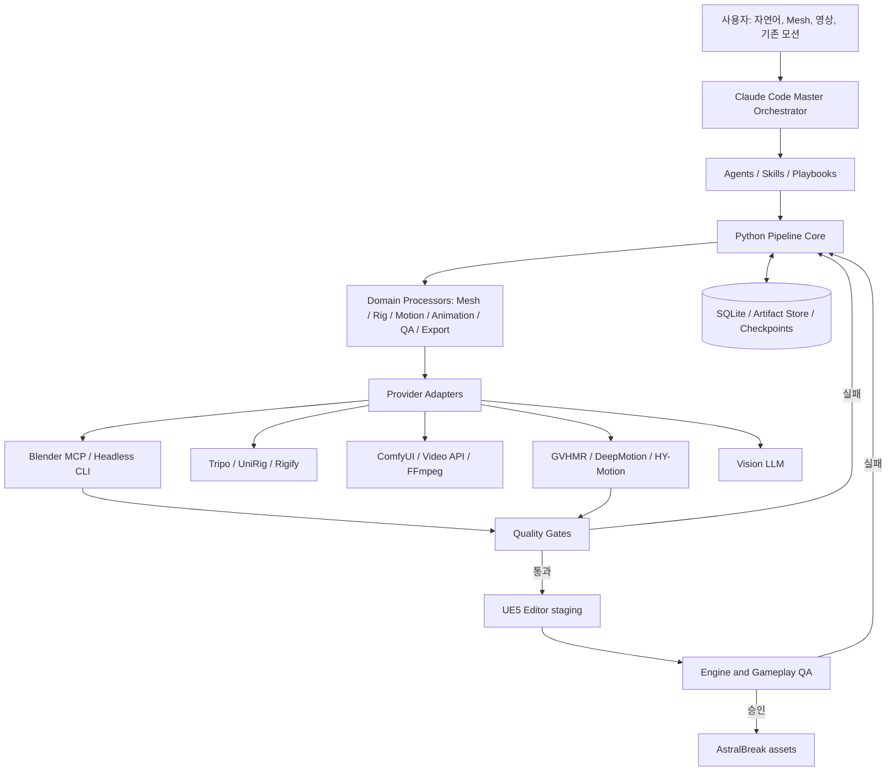
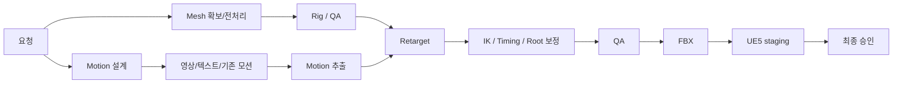

# 전체 아키텍처

Control plane: Claude가 요구사항 해석, 계획, 도구 선택, 시각적 평가, 실패 진단 및 수정 전략을 담당한다. Execution plane: Python이 작업 실행, 파일/상태 관리, 정량 검사, 비용 제한, 복구를 강제한다. Claude 세션 종료와 무관하게 작업 재개 가능해야 한다.

| 계층 | 책임 |
|---|---|
| Agent/Skill | 전문 지식 및 작업 계획 |
| Core | DAG, 상태, Registry, Executor, Checkpoint, Recovery, Budget, Logger |
| Domain | Mesh, Rig, Reference, Motion, Animation, Validation, Export |
| Adapter | 외부 API, GPU 도구, Blender, UE Editor 인터페이스 |
| Storage | immutable source, candidate, approved artifact, 로그, DB |

독립 작업만 병렬화한다. 동일 blend 및 UE package에 대한 동시 쓰기는 금지한다. 초기 구현은 로컬 Python CLI와 SQLite, subprocess로 충분하다. API/모델 변경은 provider 내부에 격리한다.
