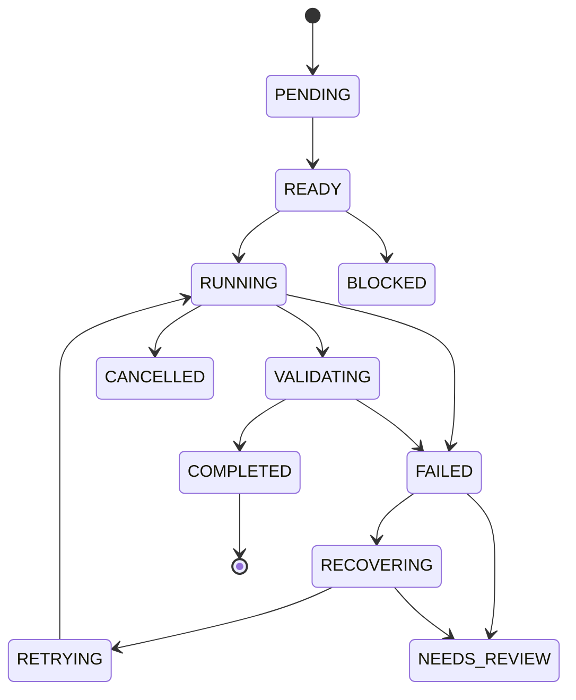

# Pipeline Core

| 모듈 | 책임 |
|---|---|
| Planner | 요청을 DAG 및 typed task specification으로 변환 |
| Executor | 의존성, timeout, cancel, worker 실행 |
| Registry / Selector | provider 능력, 호환성, 비용, 라이선스 확인 |
| State Manager | SQLite 기반 상태 전이 및 재개 |
| Artifact Manager | 해시, 버전, 원본/후보/승인 상태 |
| Checkpoint / Recovery | 스냅샷, rollback, retry, fallback |
| Validation Engine | 품질 gate, 오류 코드, 검사 보고서 |
| Budget / Logger | 비용, 재시도, 실행 명령, 도구 버전 |



Job, Task, Attempt, Artifact, Checkpoint, ValidationReport, ProviderJob, Approval 레코드를 분리한다. task에는 dependencies, input IDs, output type, timeout, budget, retry policy, idempotency key를 둔다. 원자적 DB transaction 및 파일 임시 저장 후 rename으로 부분 성공을 방지한다. crash 후 외부 job ID를 확인하고 중복 과금을 방지한다.

Provider 인터페이스 예시(미구현):

```python
from typing import Protocol
class RiggingProvider(Protocol):
    def supports(self, asset, requirements) -> bool: ...
    def submit(self, request): ...
    def get_status(self, job_id): ...
    def collect_result(self, job_id): ...
    def cancel(self, job_id): ...
```

모션/영상/mesh provider도 유사한 contract. 동기 로컬 도구는 완료된 job으로 래핑 가능. Tool Registry는 실제 설치/인증 여부를 검사한다. 비밀 키는 환경 변수 또는 secret store로 관리한다.

CLI 목표: `assetpipe mesh inspect Knight.glb`, `assetpipe rig Knight.glb --profile humanoid`, `assetpipe motion from-video Slash.mp4`, `assetpipe animation modify HeavySlash --spec attack.json`, `assetpipe validate --asset Knight`, `assetpipe rollback --job knight_001 --checkpoint rig_002`, `assetpipe resume knight_001`, `assetpipe unreal import --asset Knight`, `assetpipe run character_to_unreal --spec knight.yaml`.

완료 조건: Claude 없이 CLI에서 task 실행 및 재개 가능; 실패 주입 후 상태 및 artifact 일관성 검증; 동일 input hash/config를 기록; 외부 API job 중복 제출 방지.
