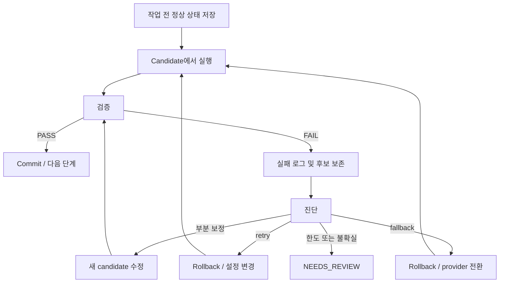

# Checkpoint / Rollback / Retry / Fallback

Checkpoint는 Claude 대화가 아니라 실제 파일 및 DB 상태다. BLEND 스냅샷, mesh/FBX/GLB, skeleton/rest pose, NPZ motion, JSON 설정/QA, PNG/MP4, UE staging manifest, provider job ID, tool version 및 파일 해시를 기록한다. 원본은 immutable. 후보는 attempt별 경로에 저장하고 승인된 artifact만 publish한다.

| 실패 | 대응 |
|---|---|
| API 연결/일시 오류 | backoff, job ID 조회 후 재시도 |
| Blender crash | 새 worker, 마지막 정상 snapshot 로드 |
| bone 배치 | 배치 보정 후 binding 재실행 |
| weight 변형 | 부분 weight 보정 또는 재바인딩 |
| rig 방식 부적합 | Tripo → Rigify/UniRig/custom (지원 여부에 따라) |
| retarget 오류 | mapping/rest pose 수정 |
| animation 불량 | IK, timing, keyframe 보정 또는 motion provider 변경 |
| FBX/UE 실패 | export 설정 검사, staging에서 재임포트 |
| 예산/횟수 초과 | 후보 보존, 사용자 검토 |

예시: Knight 원본 checkpoint → Tripo rig → 어깨 변형 실패 → 원본 복원 → Rigify 시도 → pose test 실패 → skeleton/weight 수정 → Claude MCP 부분 보정 → 검사 통과 → 승인 checkpoint. 이는 가상 시나리오다.

초기 기본값은 수정 시도 3회(정책으로 변경 가능), 작업별 총 시간/비용 한도. 같은 오류/설정 반복 감지. Rollback은 이미 소비한 API 비용을 되돌리지 못한다. 외부 side effect는 compensating action으로 처리하고 UE 승인본은 자동 삭제하지 않는다.

완료 조건: 의도적 잘못된 리깅 및 worker crash에서 원본 해시 유지, 이전 정상 BLEND 복원, 재개 및 fallback 기록, 재시도 한도 초과 시 안전 정지.
