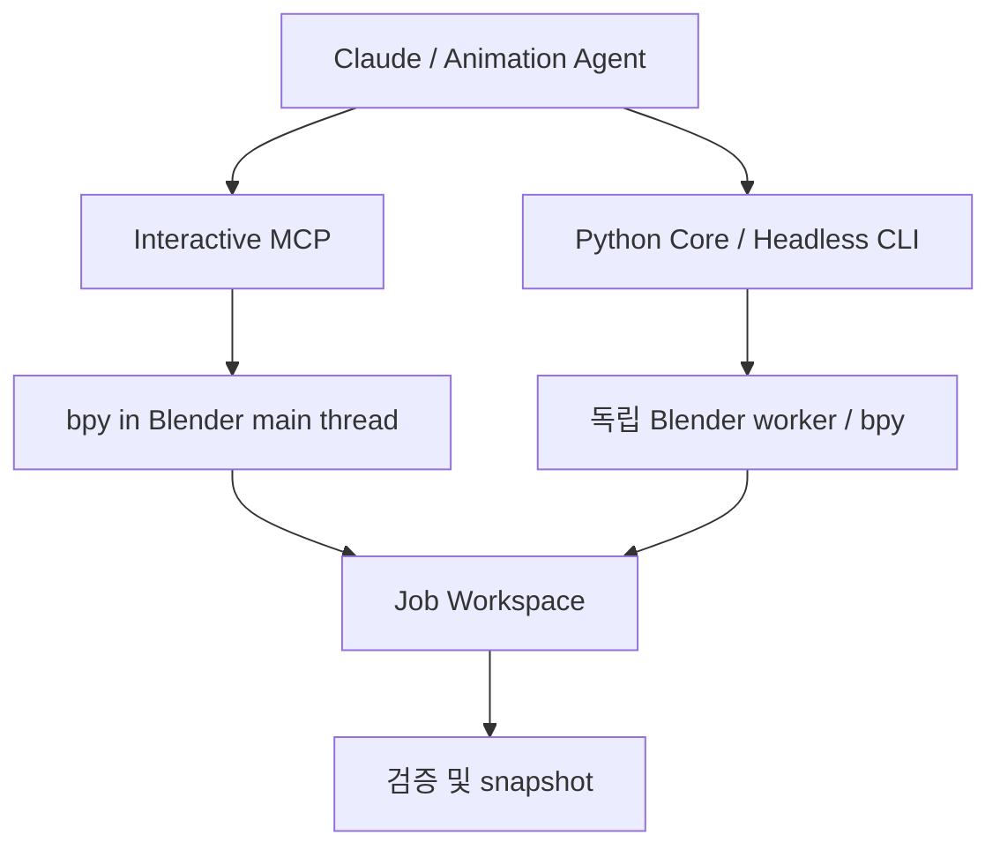

# Blender 직접 제어 및 안전



MCP는 scene 검사, viewport 캡처, 예외 처리, bone/weight/keyframe 직접 보정. CLI는 반복 가능한 전처리, binding, baking, QA, export를 담당한다. 두 경로가 동일 파일을 동시 수정하지 않도록 lock을 둔다.

Tool 후보: get_scene_info, inspect_object, analyze_mesh, clean_mesh, optimize_mesh, create_rig, edit_bone, bind_mesh, inspect_weights, normalize_weights, repair_weights, set_bone_transform, apply_pose, test_pose, create_action, insert_keyframe, edit_fcurve, create_ik_constraint, solve_weapon_grip, map_skeleton, retarget_action, bake_action, capture_viewport, render_keyposes, render_animation, create_checkpoint, restore_checkpoint, validate_rig, validate_animation, export_fbx, export_glb.

이는 목표 인터페이스이며 기존 MCP가 전부 제공한다고 가정하지 않는다. 기존 MCP 실제 schema를 조사하여 재사용/구현 여부 결정. Blender API 버전별 Action/F-Curve 차이 검사.

```bash
blender -b --python scripts/rig_character.py -- --input assets/raw/knight.glb --output assets/rigged/knight.fbx
```

안전 정책: 원본 수정 금지, job별 workspace, 변경 전 checkpoint, 승인본 overwrite 금지, 임의 Python 실행은 승인/격리, 경로 allowlist, 네트워크 및 subprocess 제한, timeout/memory limit, MCP는 로컬 인증 및 최소 권한. 다운로드된 blend의 auto-run scripts 비활성화. Hook만으로 보안을 보장하지 않는다.

완료 조건: Claude가 bone 및 keyframe을 수정하고 렌더링 확인; 잘못된 변경 rollback; headless 동일 스크립트 재실행; 금지된 경로 쓰기 거부.

참고 R02, R03, R07, T03~T05.
