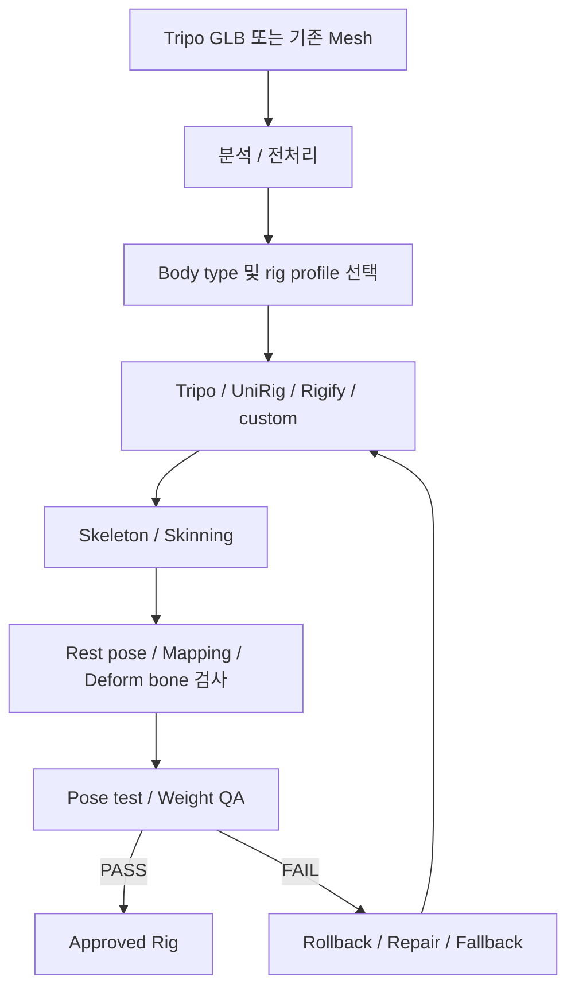

# Mesh / Rigging Pipeline

전처리: 단위, 축, transform, topology, non-manifold, 재질/texture, UV, polygon budget, LOD. 무조건 decimate/retopology 하지 말고 변형 품질과 UV 보존 검사. 무기/갑옷/망토는 필요 시 별도 mesh, rigid attachment 또는 별도 rig.

| 체형 | 우선 후보 | 대체 |
|---|---|---|
| 표준 휴머노이드 | Tripo Auto Rig | Rigify/UniRig |
| 비정형/거대 인간형 | UniRig 또는 template | custom bone fitting |
| 사족보행 | UniRig/Tripo 지원 확인 | custom template |
| 드래곤/특수 크리처 | custom/UniRig | 직접 bone 설계 |
| 이미 rigged | 기존 rig 검사/유지 | 부분 재바인딩 |

Rigify는 자동 bone placement를 기본 보장하지 않으므로 metarig fitting 필요. Tripo 지원 체형 및 skeleton 옵션은 실제 API 버전 확인. UniRig checkpoint 및 라이선스 검토.

입력 manifest: asset ID, source, body type, rest pose(T/A/custom), dimensions, materials, skeleton profile, target platform, license. 생성 단계부터 팔다리 분리, 명확한 관절, 중립 pose를 권장한다.

QA: hierarchy, root, bone naming, weight sum, missing weights, shoulder/elbow/knee/hip pose tests, 갑옷 관통, mesh deformation. 자동 weight 합계가 정상이어도 변형 품질이 정상이라는 보장은 없다.

완료 조건: 휴머노이드 한 개를 UE 호환 deform skeleton으로 export; 주요 관절 pose test와 재생 검사; 실패 시 복구 및 대체 시도.

참고 R04, R07, R08, T05~T08.
