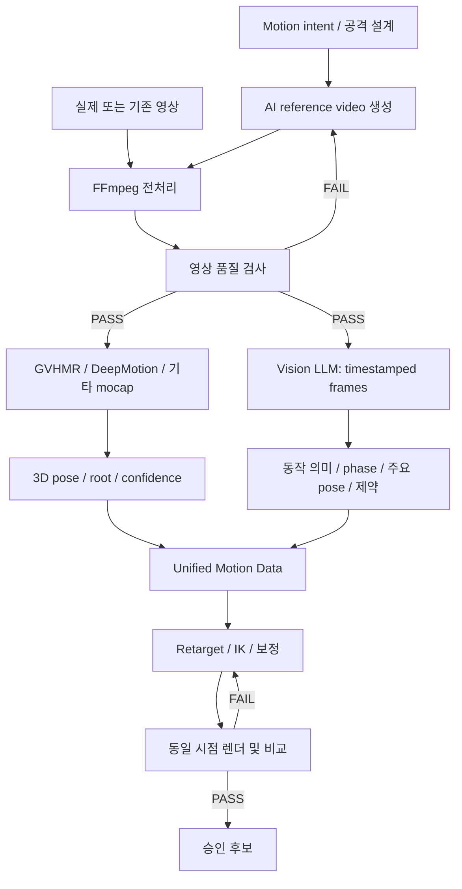

# 영상 생성 / 분석 / 모션 추출

영상 생성 후보: ComfyUI + Wan(로컬), Scenario/Kling 등 cloud provider(현재 API 및 비용 확인). 영상→모션 후보: GVHMR/WHAM(로컬), DeepMotion/Viggle(클라우드). 전문 모델과 Vision LLM 역할을 구분한다. Claude는 프레임 및 관절 데이터를 읽고 의미/수정 방향을 판단하며 직접 3D 관절을 정확히 추정하는 모델로 간주하지 않는다.

레퍼런스 프롬프트 규칙: full-body, fixed camera, three-quarter side view, plain studio, ground plane, clear hand/foot motion, consistent proportions, no cuts, no camera movement, no VFX, no blur, no slow motion. 복잡한 갑옷 대신 단순 인체 레퍼런스에 모션을 생성하고 retarget 가능.

예시: `A full-body athletic humanoid performs a two-handed greatsword slash: ready stance, raises sword, steps forward, diagonal slash, follow-through, returns to ready. Fixed camera, full body visible, plain studio, clear feet and hands, no cuts or VFX.`

FFmpeg로 trim, fps/timestamps, frame extraction; OpenCV/추적 모듈로 subject/object tracking. AI 생성 영상의 신체 왜곡, 무기 형태 변화, 가림, 프레임 불일치 검출 후 재생성. 숫자 분석은 joint position/rotation, root trajectory, foot contact, confidence; 의미 분석은 anticipation/impact/recovery, key poses, weapon constraints. 단안 영상에서 가려진 관절/무기 3D 회전 및 절대 크기에는 불확실성이 있다.

무기 tip tracking은 별도 모듈이며 2D tracking만으로 정확한 3D 무기 변환을 보장하지 않는다. 3D ground truth와 구분한다. 카메라 추정 및 시간 정렬 후 원본과 렌더링 결과 비교. 보정 한도 초과 시 영상 재생성 또는 다른 모션 경로.

Text-to-Motion은 HY-Motion 등으로 별도 provider 구현. ActionMesh 같은 4D mesh 방식은 skeletal animation과 다르므로 연구 후보로만 유지.

완료 조건: 영상 하나에서 motion 추출 → 공통 포맷 → retarget → FBX/UE 재생. AI 영상과 실제 영상 각각 테스트하여 추출 실패율/품질/비용 기록. 검증 전에는 provider 선택을 확정하지 않는다.

참고 R05, R06, R08~R11, T09~T15.
