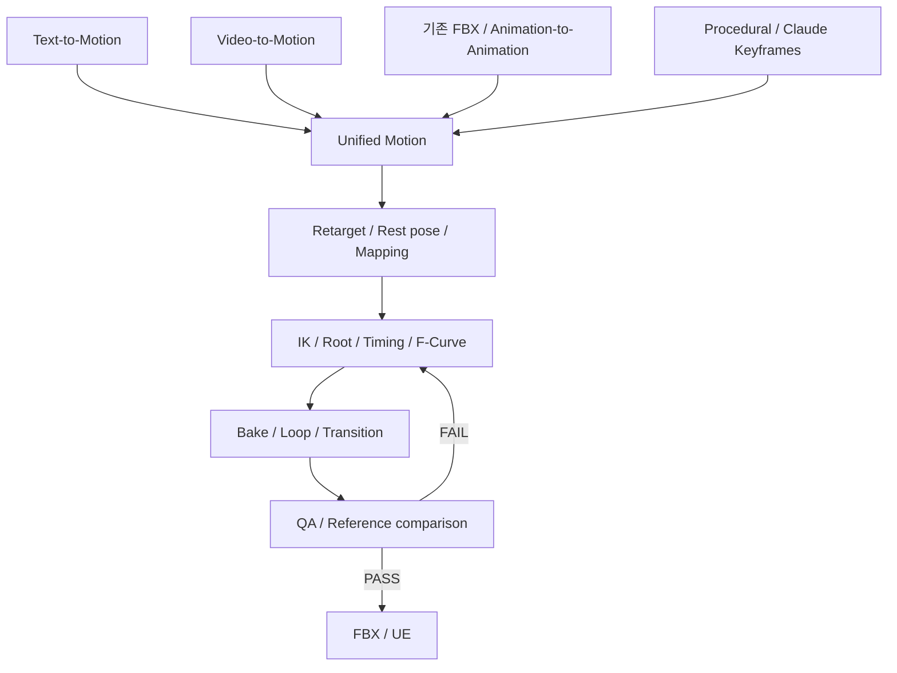

# 통합 Animation Pipeline



기본 이동은 라이브러리 또는 Text-to-Motion, 특정 레퍼런스는 Video-to-Motion, 공격 파생은 기존 모션 수정, 세밀한 자세/특수 크리처는 procedural 및 직접 제어. 복수 경로를 결합할 수 있다.

| 모듈 | 역할 |
|---|---|
| Phase Retiming | 선딜/공격/후딜 구간별 시간 변경 |
| Pose Override | bone/key pose 수정 및 additive layer |
| Grip Solver | 주 손 무기 배치, 반대 손 IK, 손가락 자세 |
| Weapon Trajectory | tip 궤적, 공격 방향, impact 후보 |
| Root Motion Editor | 이동 거리 및 회전, root/pelvis 분리 |
| Foot Contact | 지면 접지, sliding, floor penetration |
| Combo Transition | 종료/시작 pose 및 속도 연속성 |
| Mirroring | 좌우 변형 및 무기 손잡이 재검사 |
| Baking | constraint 결과를 deform bone keyframe으로 변환 |
| Loop / Compression | 반복 동작 및 출력 오차 검사 |

예시 요청: HeavySlash 선딜 단축, 전방 150cm 이동, 양손 그립 유지, 다음 콤보 연결.

```json
{
  "operation": "modify_animation",
  "source": "HeavySlash_01",
  "output": "HeavySlash_02",
  "timing": {"windup_seconds": 0.35, "attack_seconds": 0.22, "recovery_seconds": 0.45},
  "root_motion": {"forward_distance_m": 1.5},
  "constraints": {"weapon_grip": "two_handed", "foot_contact": true, "preserve_impact_pose": true},
  "transition": {"target_animation": "ComboAttack_02"}
}
```

위 파라미터는 예시이며 실제 공격 구간은 디자이너 확인 필요. Timing/Root 변경 후 foot IK와 weapon grip을 재검사한다. 원본 action을 보존하고 새 action을 생성한다. 기존 애니메이션 파일의 사용권 확인.

완료 조건: 하나의 공격을 경/강/차지 변형 중 하나로 제작; retiming, root distance, grip 검증; UE에서 재생 및 원본 비교.
