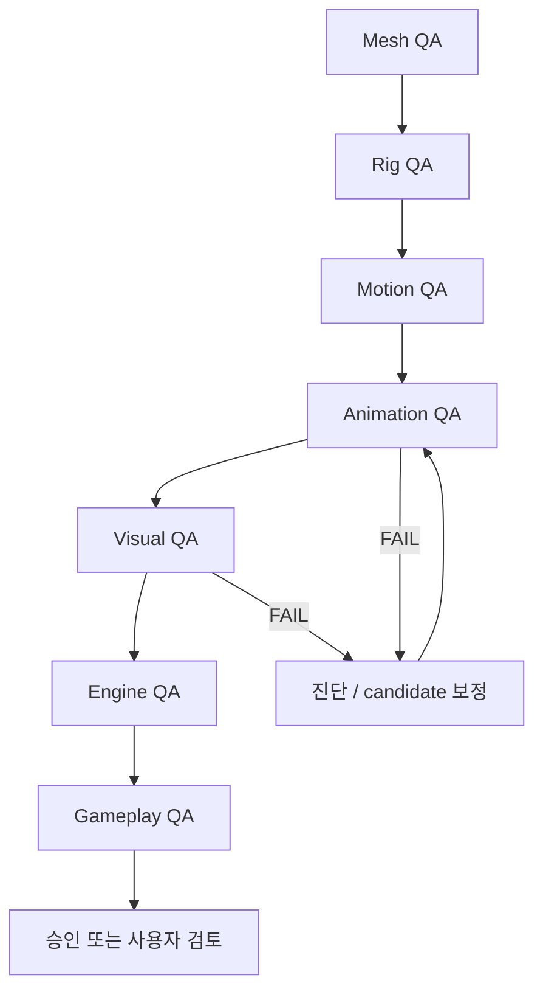

# 자동 QA 및 개선 루프

모든 gate는 PASS/FAIL/NEEDS_REVIEW와 metric, 오류 위치(프레임/bone/vertex), confidence, evidence path, 수정 제안 반환. Hard Fail을 가중 평균으로 상쇄하지 않는다. 아래는 초기 기준 제안이며 실제 측정 및 calibration 필요.

| 검사 | 기준 예시 |
|---|---|
| NaN/Inf, invalid bone refs, cycle | 0, hard fail |
| 미할당 deform vertex | 0, hard fail (rigid/nondeform 제외) |
| weight sum | 오차 0.001 이하 |
| 필수 root 및 bone | 누락 0 |
| Foot sliding | 접지 구간 이동 2cm 이하 목표 |
| Floor penetration | 1cm 이하 목표 |
| 양손 grip | 위치 오차 2cm 이하 목표 |
| Duration | 요청 대비 ±1 frame |
| Loop continuity / jerk | 동작별 기준 및 calibration |
| UE import / skeleton | profile 호환 필수 |

Reference 비교: 카메라 정렬 후 2D joint reprojection, 신체 비율 정규화; 공통 skeleton에서 quaternion angular distance; DTW 및 실제 phase duration 오차 함께 검사; root trajectory, weapon tip, foot velocity/height, acceleration/jerk; 주요 frame/다각도 렌더링 및 시각 검토. 단안 복원값은 ground truth가 아니다. 유사도 점수의 정의/가중치는 PoC에서 확정한다.

예시 정책(가상): pose 30%, foot 20%, grip 30%, timing 20%, 각 항목 85 이상 목표. 필수 grip 실패 시 높은 총점이어도 수정. 미확정 점수/정확도를 실제 측정값처럼 보고하지 않는다.

QA loop는 수치 및 렌더 결과 → Claude 진단 → 제한된 수정 → 재검증. 최대 시도/비용 한도, best candidate 보존, 사용자 승인. 시각 검사는 프레임만으로 타격감 완전 평가 불가; UE playback 및 실제 플레이 테스트 필수.

완료 조건: 의도적인 잘못된 weight, foot slide, duration, grip 및 invalid skeleton을 탐지하는 fixture; false pass/false fail 기록; 보고서에서 오류 프레임/수정 내역 추적 가능.
